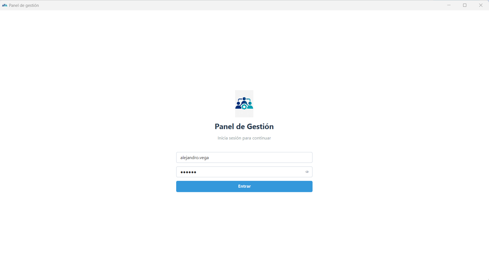
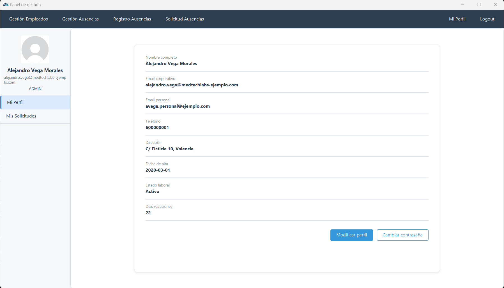
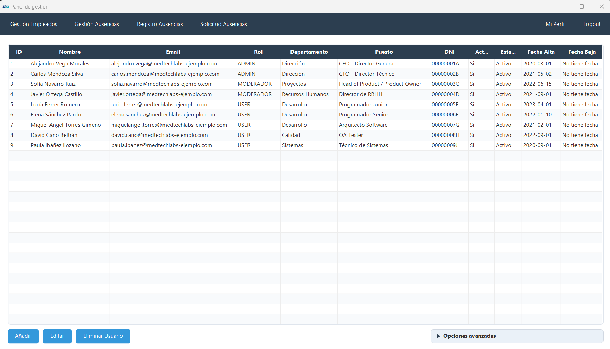
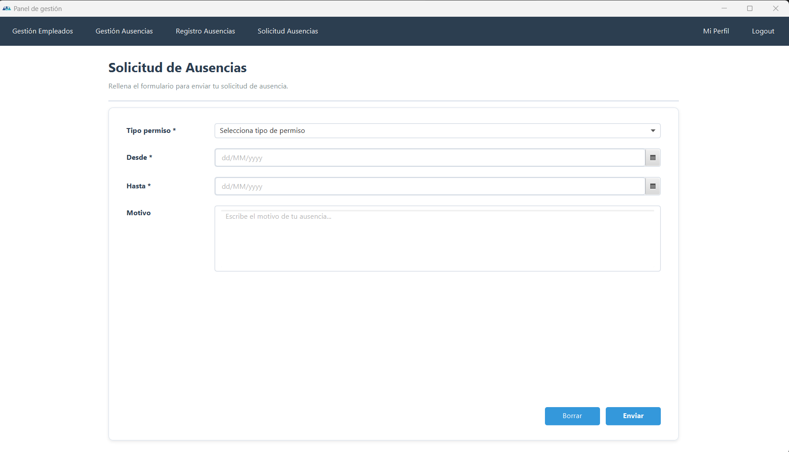

# Gestión de empleados y ausencias

Aplicación de escritorio para gestionar la plantilla de una empresa y las ausencias de sus empleados. Proyecto en equipo de primer curso de DAW.

## Funcionalidades

- Login con roles (administrador y empleado)
- Gestión de empleados: alta, modificación y baja, estado laboral y días de vacaciones
- Solicitud de ausencias por parte del empleado
- Gestión y registro de ausencias por parte del administrador
- Perfil de usuario con modificación de datos, cambio de contraseña y consulta de sus solicitudes

## Tecnologías

- Java
- JavaFX
- MySQL
- AWS

## Estructura del proyecto

Arquitectura en capas:

- `model`: clases de datos (empleado, ausencia...)
- `database`: conexión y acceso a la base de datos
- `service`: lógica de negocio y validaciones
- `controller`: controladores de JavaFX y vistas

## Validaciones y reglas de negocio

Las validaciones están en la capa `service`, separadas de la interfaz:

- Campos obligatorios y formato de datos (DNI, email, teléfono, número de la Seguridad Social y edad mínima)
- La fecha de fin de una ausencia no puede ser anterior a la de inicio
- Control de solapamiento entre ausencias del mismo empleado
- Control de días de vacaciones disponibles
- Permisos y registro según el rol del usuario (asignación de rol y auditoría del administrador)
- Control de duplicados (DNI, puestos únicos como CEO/CTO y tipos de ausencia)

## Capturas

### Login

### Mi perfil

### Gestión de empleados

### Solicitud de ausencias

## Cómo ejecutarlo

1. Clona el repositorio
2. Ejecuta el script `documentacion/BD/MER_DDL/sql-proyecto.sql` en tu base de datos MySQL
3. Ajusta url,usuario y contraseña en `src/main/java/com/example/proyecto/database/ConexionBD.java`
4. Ejecuta `App`

Usuario de prueba: `alejandro.vega` / `123456`

## Autores

Proyecto realizado en equipo por:

luisgimz y el Equipo Beta · Proyecto de primer curso de DAW